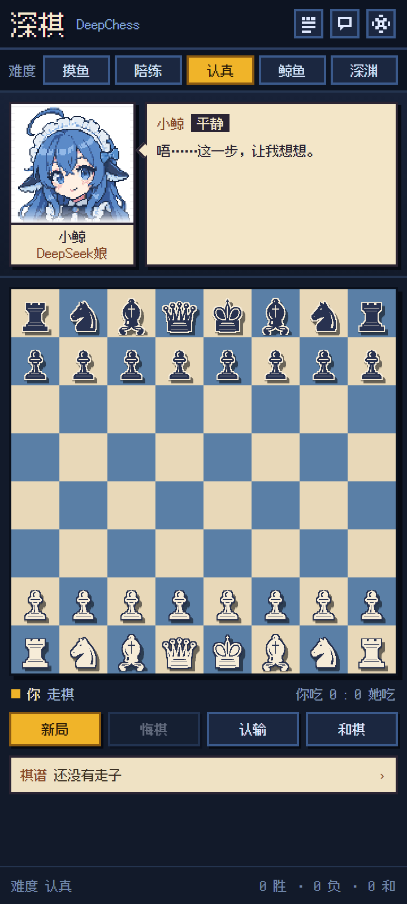

# 深棋 DeepChess

右侧栏里的像素风国际象棋：对手是 DeepSeek 娘「小鲸」，会看棋、会斗嘴、会记住你刚送了什么。

GitHub：https://github.com/BlinB209/deepchess



- 完整国际象棋规则（易位、吃过路兵、升变、将死/逼和、50 回合、三次重复、子力不足）
- 五档 AI：摸鱼 / 陪练 / 认真 / 鲸鱼 / 深渊，面板顶部直接切换
- 18 种表情，按局面和事件切换，带情绪历史避免连续重复
- 对话不是固定台词池：事件分类 + 局面上下文 + 冷却与相似度去重
- 一次性特殊对话：第一次吃子/将军、换后、升变、翻盘、连续送子、50 回合、三次重复、将死
- 可以点一下立绘「戳」她；她会按当前心情回一句
- 走子有滑行动画、将军有棋盘抖动
- 她有权拒绝和棋：领先或均势时她会说不，只有明显劣势才考虑接受
- 纯本地：存档在 `localStorage`，不联网、不写会话日志

## 安装

```text
git clone https://github.com/BlinB209/deepchess.git D:\deepchess
plugin_manager install_bundle(target = "D:\\deepchess")
```

装完刷新/重启 Harness，在右侧栏点「＋」→「深棋」打开。右侧栏收起时，用会话标题栏右上角的展开按钮回来。

## 操作

- 点自己的棋子，再点目标格；有合法点提示
- 升变会弹出后/车/象/马选择
- 底部：新局、悔棋、认输、和棋
- 顶部难度条：摸鱼 / 陪练 / 认真 / 鲸鱼 / 深渊，立即生效
- 右上：棋谱、聊天记录、设置
- 点立绘：戳她一下
- 走子时目标棋子会从起点滑到终点（只有一个棋子，没有残影），将军会抖棋盘
- 设置里可改难度、执白/执黑、说话频率、音效、翻转棋盘、走法提示

## 难度

| 档位 | 搜索 | 特点 |
|---|---|---|
| 摸鱼 | 1 层 + 高失误率 | 会送子，适合试玩 |
| 陪练 | 2 层 | 会走基本战术，偶尔看漏 |
| 认真 | 5 层 | 默认档，正常对局不送子 |
| 鲸鱼 | 7 层 | 会算连续手段，开始惩罚松散着法 |
| 深渊 | 9 层 | 2–4 秒长考，会找战术；默认不选，慎点 |

## 对话怎么做到不重复

`src/persona.js` 里按事件分池：开局、普通走子、吃子、将军、失误、好棋、长考、残局、悔棋、认输、胜负、和棋、升变、易位、吃过路兵、提和、待机。每句可以带 `{move}`、`{piece}`、`{captured}` 等局面变量。

运行时还会：

1. 最近 24 句不重复；
2. 与最近 8 句做 3-gram 相似度比较，优先挑最不像的；
3. 偶尔加短反应或尾巴，避免每句都完整；
4. 关键事件必说话，普通走子按「安静/正常/话多」概率触发；
5. 失误/悔棋会触发回调池：第几次送子、退了几次棋，她记得；
6. 开局会按当前难度改口（「深渊模式。输了别哭。」）；
7. 点立绘会触发「戳一下」的独立回应，按心情变脸；
8. 55% 的普通台词走「可爱」池（「唔……让我想想。」「你、你居然吃它！」），不再全是干巴巴的短句；
9. 一局一次的特殊对话：第一次吃子、第一次将军、换后、升变、翻盘、连续三次送子、长局、残局、三次重复、五十回合、将死/被将死。

## 表情

`assets/portraits/` 下 18 张 96×96 原生、384×384 显示：calm、smile、smug、laugh、annoyed、angry、pout、panic、surprised、sad、cry、tired、thinking、wink、love、determined、embarrassed、sleepy。

`chooseMood()` 根据评估差、将军、失误、胜负、长局等选表情，并避开最近 6 次用过的情绪；18 种表情都有可达的触发事件（喜欢/眨眼/困倦也有对应池子），不会再长期停在平静/微笑。

立绘不再硬抠白底：白荷叶边和纯白背景本来就分不开，硬抠会留下白边和断掉的呆毛。现在改成**纸质人物卡**——白色照片区 + 米色卡纸 + 底部渐隐，白底和花边自然融合，呆毛保持完整。

## 字体

界面使用 **Ark Pixel Font 12px（方舟像素字体）**，OFL-1.1，已内嵌为 woff2；中文、英文、数字都是像素字形。标题用 24px（2×）保持锐利。

## 文件

```text
index.js            Host 半边（空）
client.js           构建产物（含表情、棋子、字体）
src/engine.js       0x88 规则引擎
src/ai.js           negamax + 静态搜索 + 空着/LMR
src/persona.js      台词库与出话逻辑
src/panel.js        React 面板
src/styles.js       像素样式
src/build.mjs       构建脚本
test/perft.mjs      规则引擎 perft
test/ai.mjs         AI 自对弈与性能
```

修改 `src/` 后运行：

```bash
node src/build.mjs
node test/perft.mjs
node test/ai.mjs
```

## 署名

- 角色设计：**上善无形**（原始鲸鱼娘）、**ZipZipPipe**（DeepSeek 女仆二次设计），**CC BY-NC-SA 4.0**；本插件为非商业本地使用，表情图基于该设计生成。
- 像素字体：**Ark Pixel Font**，**OFL-1.1**，见 `LICENSE-OFL.txt`。
- 棋子：Unicode 国际象棋符号栅格化，未分发字体文件。
- 代码：MIT，见 `LICENSE`。

## 已知限制

- 台词是中文；英文界面只翻译 UI 和少量短句。
- 没有联机、没有棋钟、没有开局库。
- 头像为胸像，不包含下半身。
