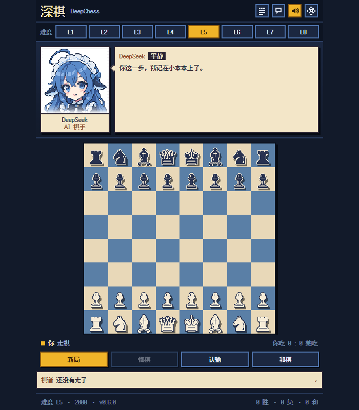

# 深棋 DeepChess

为 **DeepSeek Harness** 右侧栏打造的像素风国际象棋插件。对手是 DeepSeek（像素少女形象）：认真陪你下棋，偶尔斗嘴、鼓脸，也会为你的好棋开心。

- GitHub：https://github.com/BlinB209/deepchess
- 版本：0.6.0
- 更新日志：[CHANGELOG.md](CHANGELOG.md)
- 许可：代码 MIT；角色素材 CC BY-NC-SA 4.0（非商业）


## 简介

- 纯前端 DSH 右侧栏插件，安装后刷新即可打开
- 完整国际象棋规则（易位、吃过路兵、升变、将死/逼和、50 回合、三次重复、子力不足）
- 八档 AI：L1–L8，参考 Lichess 的电脑分级（800 / 1100 / 1400 / 1700 / 2000 / 2200 / 2500 / 3000），面板顶部直接切换
- 18 种表情，与对应台词一起切换，按双方视角和事件选情绪
- 对话不是固定台词池：事件分类 + 局面上下文 + 冷却与相似度去重
- 一次性特殊对话：双方第一次吃子/将军、双后离场、升变、翻盘、连续失误、长局、规则和棋、将死
- 开局识别：意大利、西班牙、西西里、法兰西、卡罗-卡恩、后翼弃兵、伦敦、王翼印度等
- 棋评：好棋 / 妙棋 / 小失误 / 臭棋 / 大臭棋；DeepSeek 失误会沮丧，自己下出好棋会得意，用户下出好棋会慌张，用户下臭棋会被调侃
- 可以点一下立绘「戳」她；她会按当前心情回一句
- 走子有滑行动画、将军有棋盘抖动
- 可选音效：落子 / 吃子 / 将军 / 胜负；右上角喇叭按钮可一键静音，设置里也有音效开关
- 她有权拒绝和棋：领先或均势时她会说不，只有明显劣势才考虑接受
- 纯本地：存档在 `localStorage`，不联网、不写会话日志

宽面板效果：



## 安装

```text
git clone https://github.com/BlinB209/deepchess.git D:\deepchess
plugin_manager install_bundle(target = "D:\\deepchess")
```

装完刷新/重启 Harness，在右侧栏点「＋」→「深棋」打开。右侧栏收起时，用会话标题栏右上角的展开按钮回来。

## 操作

- 点自己的棋子，再点目标格；有合法点提示
- 升变会弹出后/车/象/马选择
- 底部：新局、悔棋、认输、和棋
- 顶部难度条：L1–L8，立即生效；悬停或页脚可看参考分
- 右上：棋谱、聊天记录、音效开关、设置
- 点立绘：戳她一下
- 键盘：`Tab` 进入棋盘，方向键移动焦点，`Enter`/`Space` 选子
- 浅色主题：跟随 DSH 的 `data-theme="light"` 自动换浅色板
- 走子时目标棋子会从起点滑到终点（只有一个棋子，没有残影），将军会抖棋盘
- 设置里可改难度、执白/执黑、说话频率、音效、翻转棋盘、走法提示

## 难度

| 档位 | 搜索 | 特点 |
|---|---|---|
| L1 · 800 | 1 层 + 高失误率 | 会送子，适合试玩 |
| L2 · 1100 | 2 层 | 会走基本战术，偶尔看漏 |
| L3 · 1400 | 3 层 | 开始抓明显失误 |
| L4 · 1700 | 4 层 | 正常对局不乱送 |
| L5 · 2000 | 5 层 | 默认档，会惩罚松散着法 |
| L6 · 2200 | 6 层 | 算得更深，失误更少 |
| L7 · 2500 | 7 层 | 会算连续手段 |
| L8 · 3000 | 9 层 | 2–4 秒长考；纯 JS 引擎，参考分不代表真实 Stockfish 3000 |

## 对话怎么做到不重复

`src/persona.js` 里按事件分池：开局、普通走子、吃子、将军、失误、好棋、长考、残局、悔棋、认输、胜负、和棋、升变、易位、吃过路兵、提和、待机。每句可以带 `{move}`、`{piece}`、`{captured}`、`{promotion}` 等局面变量。双方走子分别处理，不会把她吃后说成自己的后丢了，或把升车说成升马。

DeepSeek 的日常语气以亲近、陪伴为主，保留少量吃子时得意、被戳时鼓脸、输棋后不服气的玩笑。失误时温和提醒，长考时不催促，胜负都愿意继续陪你下。

运行时还会：

1. 优先排除最近 24 句实际显示过的台词；小台词池用完后，先复用最久没说的句子；
2. 填入棋局变量后，与最近 8 句做 3-gram 相似度比较；中英文使用同一套去重逻辑；
3. 按事件和表情选择完整台词，避免随机拼接出矛盾的语气；
4. 关键事件必说话，普通走子按「安静/正常/话多」概率触发；
5. 失误/悔棋计数和已触发的特殊事件保存在本地；连续失误单独统计，正常走子或悔棋会中断连续计数；
6. 开局区分执白/执黑；切换难度有对应回应（「L7，两千五。鲸鱼要认真了。」）；
7. 点立绘会触发「戳一下」的独立回应，按心情变脸；
8. 每句留出约 2.2–5.2 秒阅读时间；思考提示与台词同时显示，终局立即优先显示；新走子、新局和悔棋会取消过时的待说台词；
9. 点立绘有 2 秒冷却，不打断正在读的走子反馈；环境闲聊有 12 秒冷却，安静模式不主动催棋或待机发言；
10. 将军优先于普通吃子，一次性特殊事件按双方视角分别处理；升变后的台词会说出实际选择的棋子。

`src/dialogue.js` 用「候选走法 + 对方一手应对」粗估失误，不再直接把走子前后的静态分差当作送子证据。这只是浅层判断，不是完整复盘分析，因此台词使用「可能有点亏」等谨慎措辞。

## 表情

`assets/portraits/` 下 18 张 96×96 原生、384×384 显示：calm、smile、smug、laugh、annoyed、angry、pout、panic、surprised、sad、cry、tired、thinking、wink、love、determined、embarrassed、sleepy。

`chooseMood()` 从 DeepSeek 自己的视角，根据评估差、将军、失误、胜负、长局等选表情，并优先避开最近 6 次显示的情绪。表情随实际显示的台词更新，没说话时不随机变脸；普通开局不会突然困倦，落后时也不会因为执黑/执白弄反而得意。

立绘不再硬抠白底：白荷叶边和纯白背景本来就分不开，硬抠会留下白边和断掉的呆毛。现在改成**纸质人物卡**——白色照片区 + 米色卡纸 + 底部渐隐，白底和花边自然融合，呆毛保持完整。

## 字体

界面使用 **Ark Pixel Font 12px（方舟像素字体）**，OFL-1.1，已内嵌为 woff2；中文、英文、数字都是像素字形。标题用 24px（2×）保持锐利。

## 文件

```text
index.js            Host 半边（空）
client.js           构建产物（含表情、棋子、字体）
src/engine.js       0x88 规则引擎
src/ai.js           negamax + 静态搜索 + 空着/LMR
src/persona.js      台词库与出话逻辑
src/dialogue.js     事件判断、局面粗估、发言调度与冷却
src/panel.js        React 面板
src/styles.js       像素样式
src/build.mjs       构建脚本
test/perft.mjs      规则引擎 perft
test/ai.mjs         AI 自对弈与性能
test/persona.mjs    人设、双语、台词去重与表情
test/dialogue.mjs   发言排队、事件优先级与双方视角
test/panel.mjs      面板状态与计时器回归检查
```

修改 `src/` 后运行：

```bash
node src/build.mjs
node --test test/persona.mjs test/dialogue.mjs test/panel.mjs
node test/perft.mjs
node test/ai.mjs
```

## 署名

- 角色设计：**上善无形**（原始鲸鱼娘）、**ZipZipPipe**（DeepSeek 女仆二次设计），**CC BY-NC-SA 4.0**；本插件为非商业本地使用，表情图基于该设计生成。
- 像素字体：**Ark Pixel Font**，**OFL-1.1**，见 `LICENSE-OFL.txt`。
- 棋子：Unicode 国际象棋符号栅格化，未分发字体文件。
- 代码：MIT，见 `LICENSE`。

## 已知限制

- 中英文均有事件台词；英文池较小，同一事件反复发生时会更早复用。
- 没有联机、没有棋钟、没有开局库。
- 头像为胸像，不包含下半身。
